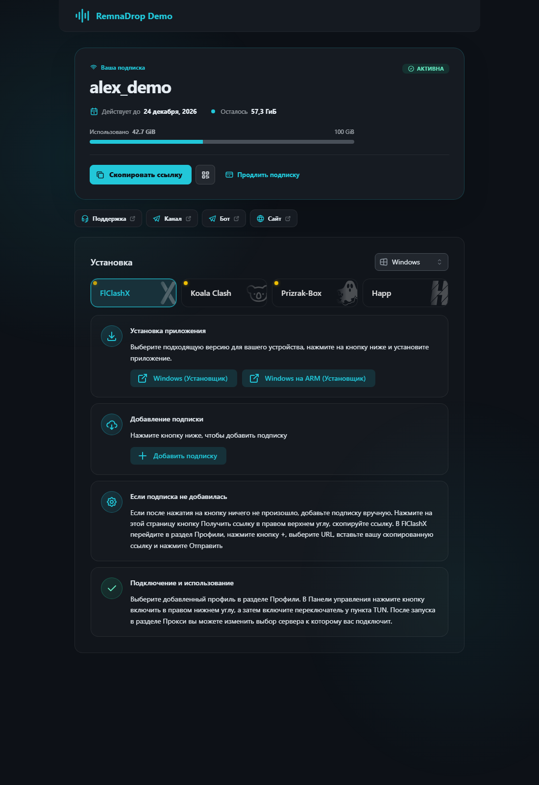

# RemnaDrop Subpage

Отдельная страница подписки для [RemnaDrop](https://github.com/ap1w1/remnadrop). Исходная основа — [Remnawave Subscription Page 7.2.6](https://github.com/remnawave/subscription-page/tree/7.2.6), лицензия AGPL-3.0-only сохранена в [LICENCE](LICENCE).



## Что показывает страница

- Статус подписки, дату окончания и общий расход трафика.
- Короткую строку действий: копирование ссылки, QR-код и **«Продлить подписку»**.
- Настроенные в панели ссылки поддержки, Telegram и сайта.
- Инструкцию по установке приложения для выбранной платформы.

Ссылка **«Продлить подписку»** берётся из поля `web-page-stub` (`brandingSettings.webPageStub`) в **RemnaDrop → Подписка → Subpage Editor → Брендинг**. Если поле пустое, кнопка скрыта. Лимиты трафика отдельных нод на странице не показываются. Цветовая схема выбирается в первой карточке Subpage Editor; настройки хранятся в панели.

## Быстрый старт

На сервере с Docker Engine и Compose v2:

```bash
git clone https://github.com/ap1w1/remnadrop-subpage.git /opt/remnadrop-subpage
cd /opt/remnadrop-subpage
cp .env.sample .env
```

В `.env` укажите адрес панели `REMNAWAVE_PANEL_URL`, действующий `REMNAWAVE_API_TOKEN` и остальные параметры вашей установки. Не публикуйте `.env`. Если Subpage уже установлен через `remnawave-scripts`, используйте его действующий `.env`, сеть и reverse proxy; в его compose-файле замените только имя образа на `remnadrop/subpage:latest`.

```bash
docker build -t remnadrop/subpage:latest .
docker compose -f docker-compose-prod.yml up -d --no-deps remnawave-subscription-page
docker compose -f docker-compose-prod.yml ps remnawave-subscription-page
```

Compose-файл предполагает существующую внешнюю сеть `remnawave-network` и порт `127.0.0.1:3010`. При другой схеме установки сохраните текущие сеть, порт и прокси.

## Много страниц и обновление настроек

Контейнер **не загружает все конфигурации при запуске**. Он получает только запрошенную страницу и хранит до 512 конфигураций в памяти. Повторные одновременные запросы одной конфигурации объединяются. Настройки перепроверяются каждые 15 секунд; при кратковременной недоступности панели используется последняя корректная версия.

После изменения цвета, ссылок или текста в Subpage Editor **перезапуск контейнера не нужен**: обновите страницу в браузере, и актуальная конфигурация появится не позднее 15 секунд после предыдущего запроса к ней. Это касается настроек страниц; для обновления самого кода образ по-прежнему нужно пересобрать и пересоздать контейнер.

В сборке используются системные шрифты. Страница не запрашивает Google Fonts и не упаковывает десятки файлов шрифтов; статические ресурсы кешируются браузером на сутки.

## Обновление кода

```bash
cd /opt/remnadrop-subpage
git pull --ff-only
docker build -t remnadrop/subpage:latest .
docker compose -f docker-compose-prod.yml up -d --no-deps remnawave-subscription-page
```

## Связь с панелью

Панель отвечает за пользователей, конфигурации Subpage, цвета и подстановку переменных `{{EMAIL}}`, `{{ID}}`, `{{USERNAME}}`, `{{TELEGRAM_ID}}` в URL. Этот репозиторий отвечает за отдельный контейнер страницы подписки. При обновлении панели исходный код страницы не перезаписывается.
